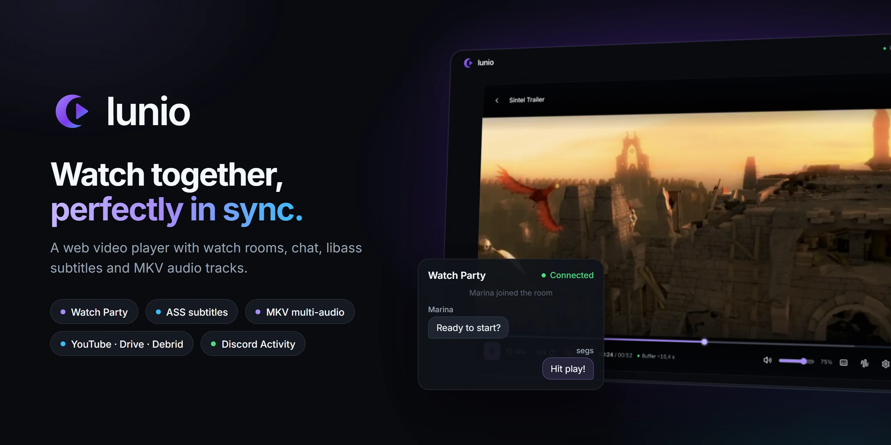
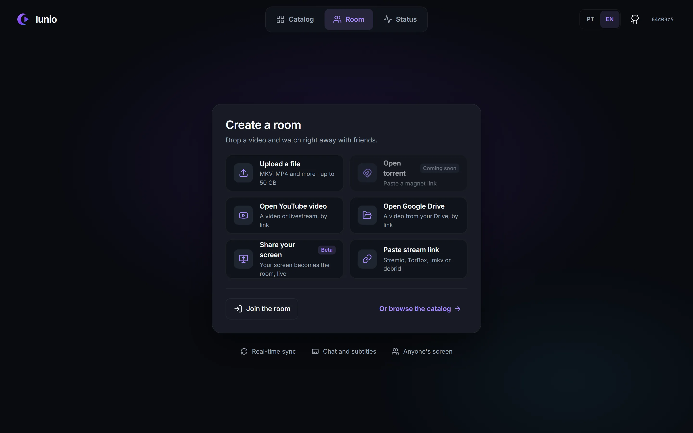
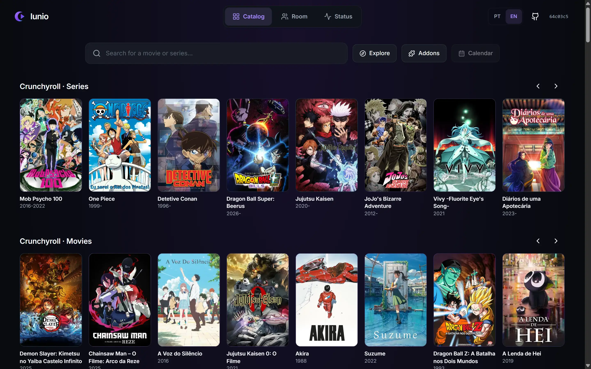
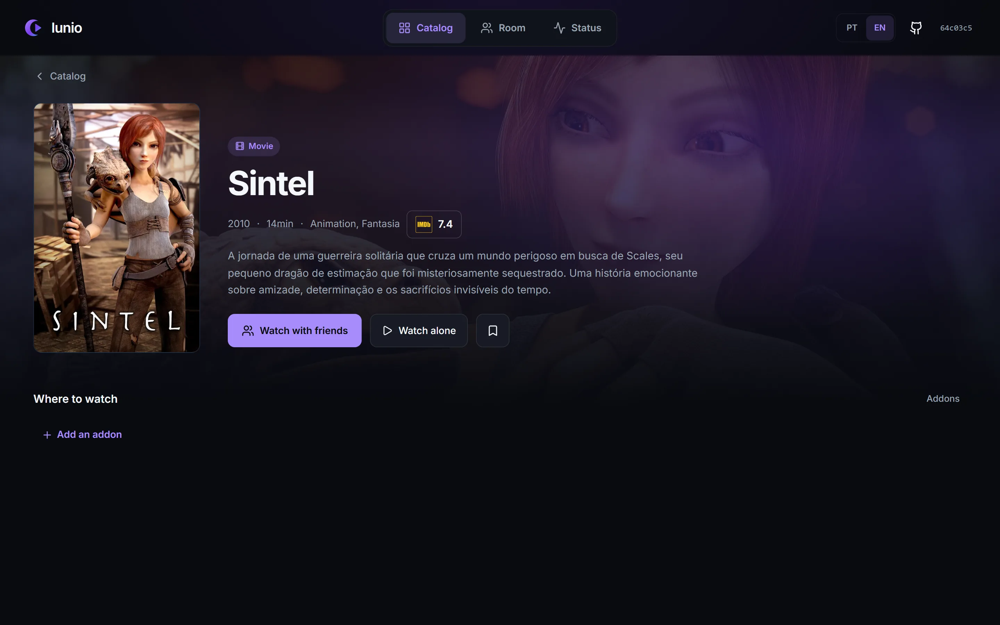
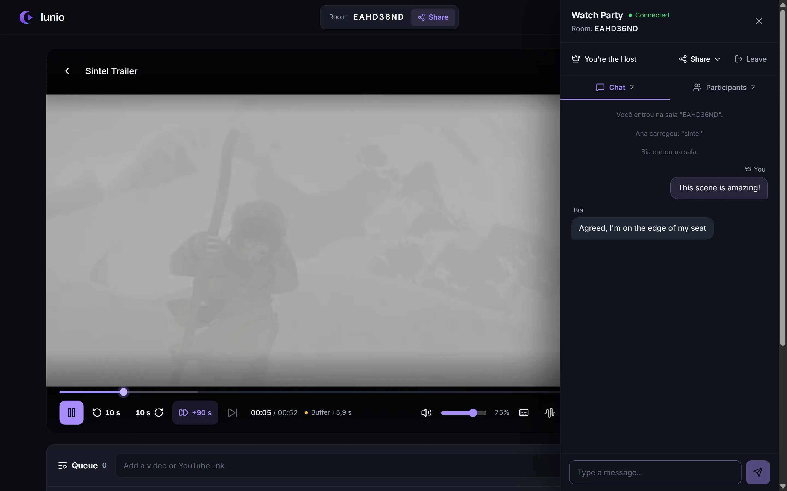
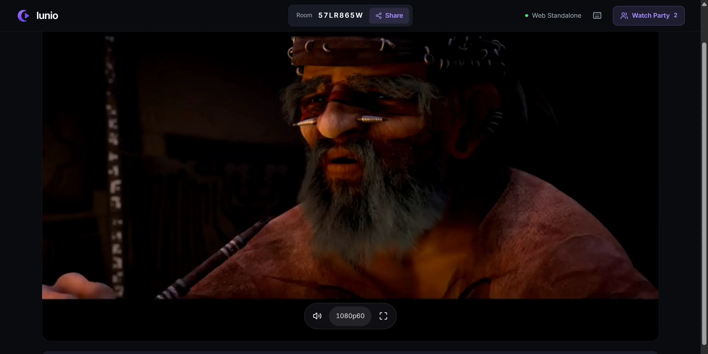
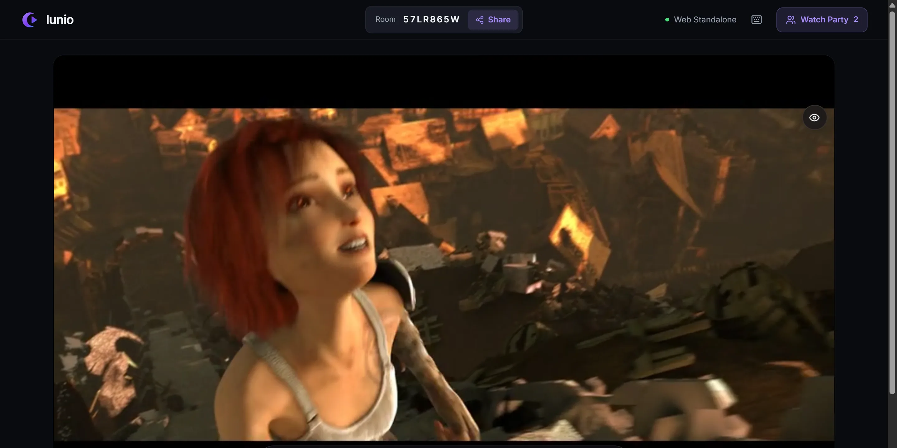

<p align="center">
  
</p>

# Lunio

**English** · [Português](README.pt-BR.md)

Lunio is a web video player made for watching together. Create a room, pick a video, share the link, and everyone watches in sync — with chat, desktop-quality subtitles and your choice of audio track. It also runs as a Discord Activity (in development).

## Features

- **Watch together** — create a room from any source and share its code or link. The Host controls play, pause and seek; everyone else stays in sync automatically. Chat, member list, Host transfer, kick and ban.
- **Queue** — anyone in the room can add videos; the Host reorders them, and the next one starts by itself.
- **Bring your own video** — paste a stream link (Stremio, debrid services, `.mkv`, `.mp4`, HLS), upload a file (up to 50 GB), or open a YouTube or Google Drive video.
- **Catalog** *(beta)* — browse and search movies and series, explore by genre, open seasons and episodes, keep a personal list and pick up where you left off. Metadata comes from a Stremio addon.
- **Addons** — add your own Stremio video addons and see *Where to watch* on every title, with a hint of whether each stream will play in your browser. Your addon links never leave your browser.
- **Screen sharing** *(experimental beta, off by default)* — the Host shares their screen and system audio with the room, up to 4K at 60 fps. Viewers have their own volume, and the Host picks the quality while live.
- **Subtitles and audio** — ASS subtitles with their original fonts and styling, plus `.srt` and `.vtt`; switch between the audio tracks of an MKV without waiting.
- **A real player** — chapter timeline, skip intro and outro (the room votes), playback speed, resume where you left off, picture-in-picture, keyboard shortcuts, and links that open at a given moment.
- **Languages** — Portuguese and English.

How each of these works under the hood is in [docs/features.md](docs/features.md).

## Screenshots

| Home | Catalog |
|---|---|
|  |  |

| Title page | Room with chat |
|---|---|
|  |  |

| Screen sharing: viewer | Screen sharing: Host |
|---|---|
|  |  |

<sub>Video in the screenshots: *Sintel* © Blender Foundation, [CC BY 3.0](https://creativecommons.org/licenses/by/3.0/).</sub>

## Getting started

You need [Node.js](https://nodejs.org) 20+, [FFmpeg](https://ffmpeg.org) and Python 3.10+ (FFmpeg and Python are used to read audio tracks and subtitles; both are found automatically).

```bash
npm install
npm run dev      # development, with hot reload
npm start        # production: builds, then runs the production server
```

Open <http://localhost:3000>. Friends on the same network can join with your machine's IP.

Nothing needs to be configured to try it locally. To put it on a server, see [Deploying](docs/deployment.md) and [Configuration](docs/configuration.md).

## Documentation

| | |
|---|---|
| [Features in detail](docs/features.md) | How each feature works and its limits |
| [Configuration](docs/configuration.md) | Every environment variable |
| [Deploying](docs/deployment.md) | Linux server with Caddy and systemd, and optional Redis |
| [Screen sharing](docs/screen-sharing.md) | The relay, privacy, browsers and cost |
| [Architecture and API](docs/architecture.md) | How the pieces fit, and the API routes |
| [Development and testing](docs/development.md) | Requirements, scripts and tests |

## Keyboard shortcuts

| Key | Action |
|---|---|
| `Space` / `K` | Play / pause |
| `J` / `←` · `L` / `→` | Back / forward 10 s |
| `Tab` | Skip the detected opening/ending (viewers vote) |
| `N` / `O` | Skip 90 s |
| `↑` / `↓` | Volume ±5% |
| `M` | Mute |
| `C` | Toggle subtitles |
| `G` / `H` | Subtitle sync ±50 ms (`Shift` for ±250 ms) |
| `[` / `]` | Audio delay ±50 ms |
| `Z` | Aspect mode |
| `F` | Fullscreen |
| `W` | Watch Party panel |

## Known limitations

- Torrent links are not supported yet (they need a torrent engine on the server).
- Screen sharing needs desktop Chrome, Edge or Brave for the Host; viewers can use Chromium browsers or Firefox. Safari and the Discord Activity are not supported.
- A ban follows the browser's identity: another browser or cleared site data starts fresh, since there are no accounts.

More in [docs/features.md](docs/features.md#known-limitations).

## Project structure

```
src/
  App.tsx                   Screens: Home (catalog, room, status) and player
  components/
    home/                   Room menu, source steps (stream, upload, YouTube, Drive, join), last room, Status tab
    catalog/                Catalog rows, search, Explore, title page, addons and streams list
    player/                 The player's hooks (room sync, alternate audio, subtitles, controls, shortcuts…),
                            overlays and the screen sharing stage
    VideoPlayer.tsx         Player composition (Vidstack)
    PlayerControls.tsx      Controls bar and menus
    WatchPartyPanel.tsx     Chat and participants
    ui.tsx                  Shared UI primitives (design system)
  lib/                      Room client (sync.ts), subtitles, media helpers, catalog, addons, continue watching
    screen/                 Screen sharing engine: capture, encode, encrypt, MoQ transport, playout
  server/                   Backend, independent of Vite
    app.ts / main.ts        API router / production entry point
    routes/                 One file per endpoint
    media/                  Proxy, tracks, subtitles, fonts, HLS, remux, uploads, cache
    roomServer.ts           Rooms: sync, chat, queue, Host, screen sharing state
    roomStore.ts            Rooms saved in Redis
  types/                    Types shared by the client and the server
mkv_extractor/              Python extractor for subtitles and keyframes inside remote MKV files (HTTP Range)
e2e/                        Playwright end-to-end tests (production server + local MKV fixture)
tests/                      Python tests (mkv_extractor)
docs/                       Technical documentation
public/                     Static files: JASSUB (libass), fallback fonts, Sintel sample
assets/                     README images (readme/) and Discord art (discord/)
DESIGN.md                   Design system notes
```

## License

[AGPL-3.0](LICENSE)
