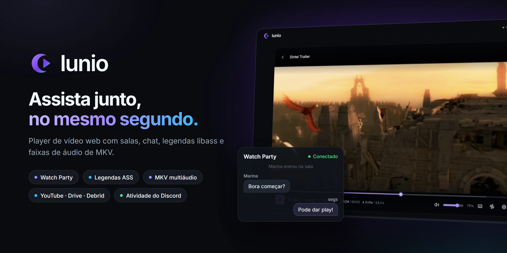
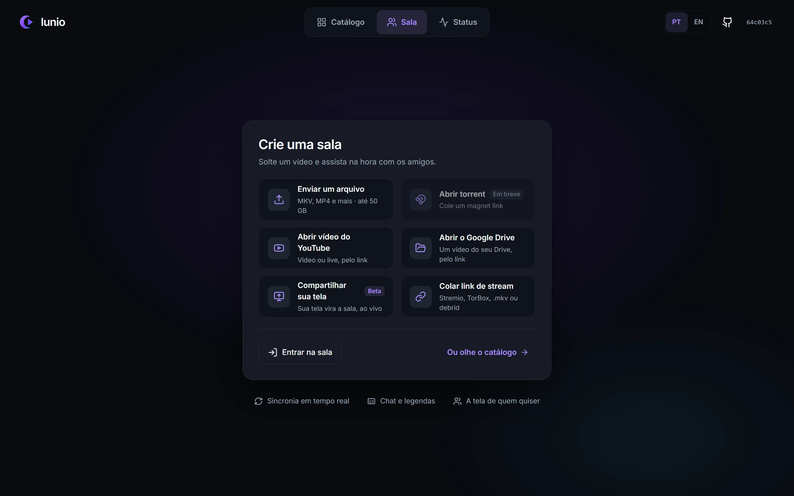
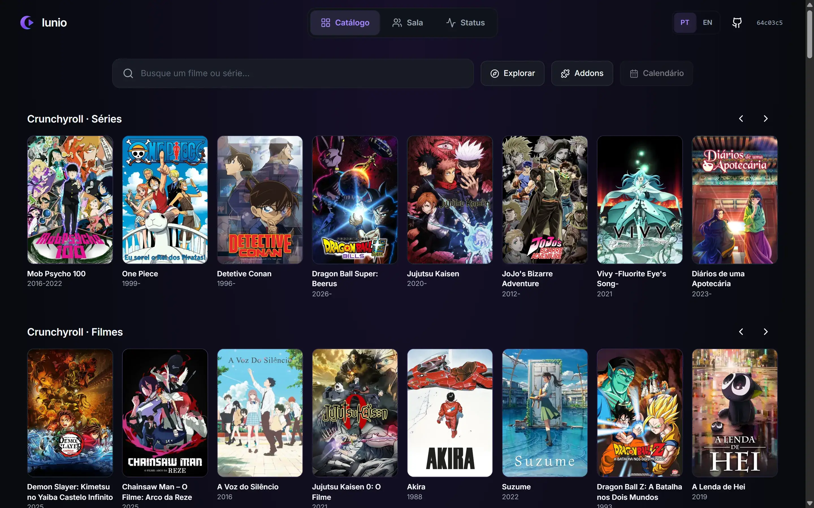
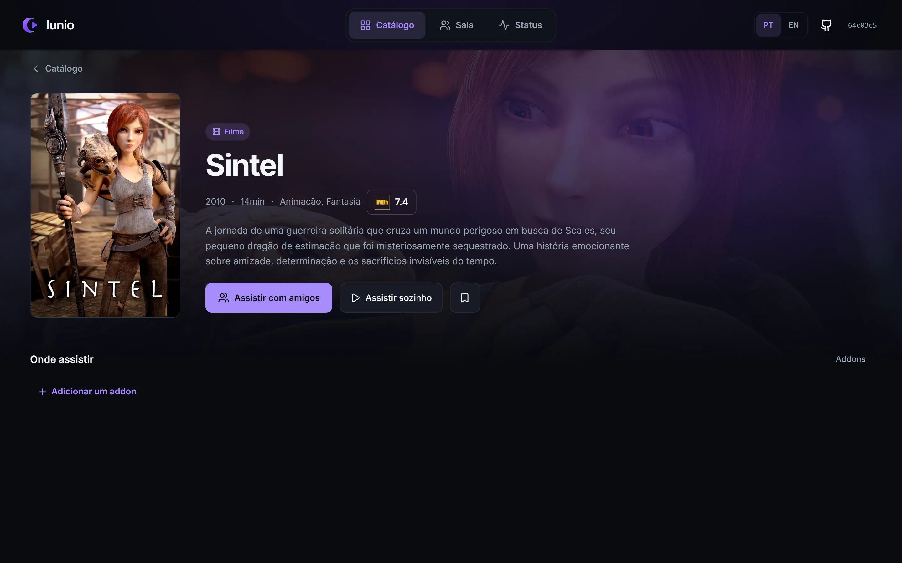
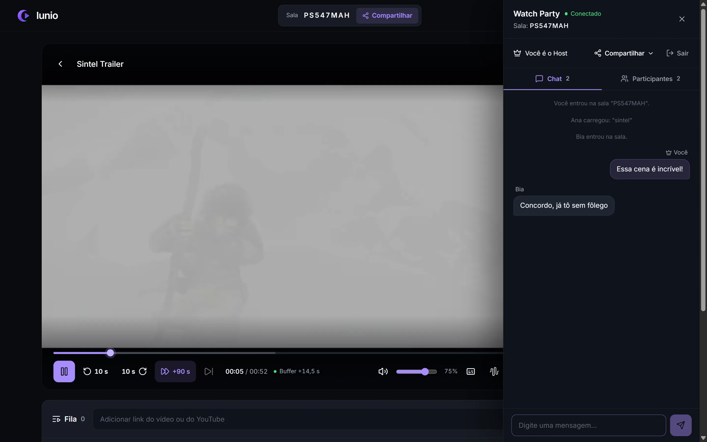
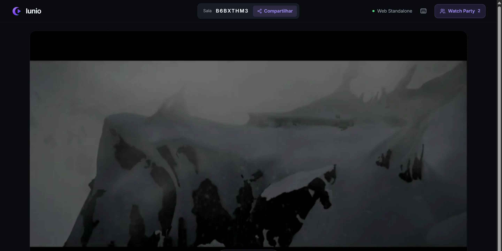
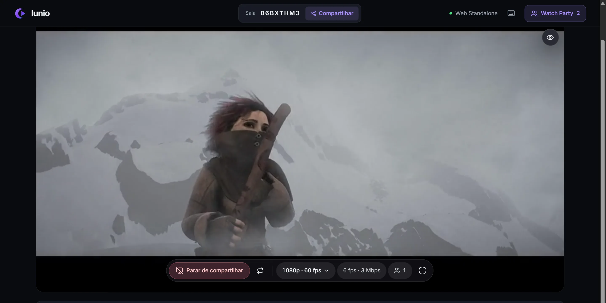

<p align="center">
  
</p>

# Lunio

[English](README.md) · **Português**

O Lunio é um player de vídeo web feito para assistir junto. Crie uma sala, escolha um vídeo, compartilhe o link e todo mundo assiste sincronizado — com chat, legendas com qualidade de player de desktop e a faixa de áudio que você quiser. Também roda como Discord Activity (em desenvolvimento).

## Recursos

- **Assistir junto** — crie uma sala a partir de qualquer fonte e compartilhe o código ou o link. O Host controla play, pause e seek; os outros acompanham sozinhos, em sincronia. Chat, lista de pessoas, troca de Host, expulsar e banir.
- **Fila** — qualquer pessoa da sala adiciona vídeos; o Host reordena, e o próximo começa sozinho.
- **Traga seu vídeo** — cole um link de stream (Stremio, serviços debrid, `.mkv`, `.mp4`, HLS), envie um arquivo (até 50 GB) ou abra um vídeo do YouTube ou do Google Drive.
- **Catálogo** *(beta)* — navegue e busque filmes e séries, explore por gênero, abra temporadas e episódios, tenha uma lista pessoal e continue de onde parou. Os metadados vêm de um addon do Stremio.
- **Addons** — adicione seus próprios addons de vídeo do Stremio e veja *Onde assistir* em cada título, com um aviso de quais streams devem tocar no seu navegador. O link dos seus addons nunca sai do seu navegador.
- **Transmissão de tela** *(beta experimental)* — o Host transmite a tela e o áudio do sistema para a sala, em até 4K a 60 fps. Quem assiste tem volume próprio, e o Host troca a qualidade com a transmissão no ar.
- **Legendas e áudio** — legendas ASS com as fontes e o estilo originais, além de `.srt` e `.vtt`; troque entre as faixas de áudio de um MKV sem esperar.
- **Um player de verdade** — timeline com capítulos, pular abertura e encerramento (a sala vota), velocidade, continuar de onde parou, picture-in-picture, atalhos de teclado e links que abrem num instante do vídeo.
- **Idiomas** — português e inglês.

Como cada um funciona por dentro está em [docs/features.pt-BR.md](docs/features.pt-BR.md).

## Capturas de tela

| Home | Catálogo |
|---|---|
|  |  |

| Página do título | Sala com chat |
|---|---|
|  |  |

| Transmissão de tela: quem assiste | Transmissão de tela: Host |
|---|---|
|  |  |

<sub>Vídeo das capturas: *Sintel* © Blender Foundation, [CC BY 3.0](https://creativecommons.org/licenses/by/3.0/).</sub>

## Como rodar

Você precisa do [Node.js](https://nodejs.org) 20+, do [FFmpeg](https://ffmpeg.org) e do Python 3.10+ (FFmpeg e Python servem para ler faixas de áudio e legendas; os dois são encontrados sozinhos).

```bash
npm install
npm run dev      # desenvolvimento, com hot reload
npm start        # produção: faz o build e roda o servidor de produção
```

Abra <http://localhost:3000>. Amigos na mesma rede entram pelo IP da sua máquina.

Para testar localmente não precisa configurar nada. Para pôr num servidor, veja [Deploy](docs/deployment.pt-BR.md) e [Configuração](docs/configuration.pt-BR.md).

## Documentação

| | |
|---|---|
| [Recursos em detalhe](docs/features.pt-BR.md) | Como cada recurso funciona e seus limites |
| [Configuração](docs/configuration.pt-BR.md) | Todas as variáveis de ambiente |
| [Deploy](docs/deployment.pt-BR.md) | Servidor Linux com Caddy e systemd, e Redis opcional |
| [Transmissão de tela](docs/screen-sharing.pt-BR.md) | O relay, privacidade, navegadores e custo |
| [Arquitetura e API](docs/architecture.pt-BR.md) | Como as peças se encaixam e as rotas da API |
| [Desenvolvimento e testes](docs/development.pt-BR.md) | Requisitos, scripts e testes |

## Atalhos de teclado

| Tecla | Ação |
|---|---|
| `Espaço` / `K` | Play / pause |
| `J` / `←` · `L` / `→` | Voltar / avançar 10 s |
| `Tab` | Pular a abertura/encerramento detectado (espectador vota) |
| `N` / `O` | Pular 90 s |
| `↑` / `↓` | Volume ±5% |
| `M` | Silenciar |
| `C` | Ligar/desligar legendas |
| `G` / `H` | Sincronia da legenda ±50 ms (`Shift` para ±250 ms) |
| `[` / `]` | Atraso do áudio ±50 ms |
| `Z` | Ajuste de tela |
| `F` | Tela cheia |
| `W` | Painel da Watch Party |

## Limitações conhecidas

- Links de torrent ainda não são suportados (precisam de um motor de torrent no servidor).
- A transmissão de tela exige Chrome, Edge ou Brave no computador para o Host; quem assiste pode usar navegadores Chromium ou Firefox. Safari e Discord Activity não são suportados.
- O banimento vale para a identidade do navegador: outro navegador ou dados do site apagados começam do zero, já que não há contas.

Mais em [docs/features.pt-BR.md](docs/features.pt-BR.md#limitações-conhecidas).

## Estrutura do projeto

```
src/
  App.tsx                   Telas: Home (catálogo, sala, status) e player
  components/
    home/                   Menu da sala, passos de cada fonte (stream, envio, YouTube, Drive, entrar), última sala e aba Status
    catalog/                Fileiras do catálogo, busca, Explorar, página do título, addons e lista de streams
    player/                 Hooks do player (sincronia da sala, áudio alternativo, legendas, controles, atalhos…),
                            overlays e o palco da transmissão de tela
    VideoPlayer.tsx         Composição do player (Vidstack)
    PlayerControls.tsx      Barra de controles e menus
    WatchPartyPanel.tsx     Chat e participantes
    ui.tsx                  Primitivas de interface (design system)
  lib/                      Cliente da sala (sync.ts), legendas, utilitários de mídia, catálogo, addons, continuar assistindo
    screen/                 Motor da transmissão de tela: captura, codificação, criptografia, transporte MoQ, reprodução
  server/                   Backend, independente do Vite
    app.ts / main.ts        Roteador da API / entrada de produção
    routes/                 Um arquivo por endpoint
    media/                  Proxy, faixas, legendas, fontes, HLS, remux, envios, cache
    roomServer.ts           Salas: sincronia, chat, fila, Host e estado da transmissão de tela
    roomStore.ts            Salas guardadas no Redis
  types/                    Tipos compartilhados entre cliente e servidor
mkv_extractor/              Extrator Python de legendas e keyframes dentro de MKV remoto (HTTP Range)
e2e/                        Testes de ponta a ponta com Playwright (servidor de produção + MKV local de teste)
tests/                      Testes Python (mkv_extractor)
docs/                       Documentação técnica
public/                     Estáticos: JASSUB (libass), fontes de reserva, vídeo de exemplo Sintel
assets/                     Imagens do README (readme/) e arte do Discord (discord/)
DESIGN.md                   Notas do design system
```

## Licença

[AGPL-3.0](LICENSE)
