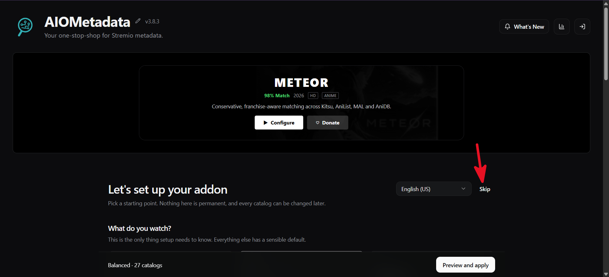
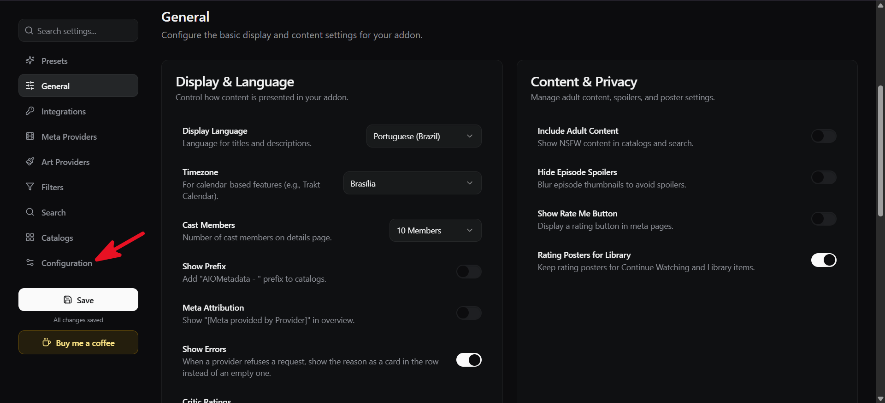
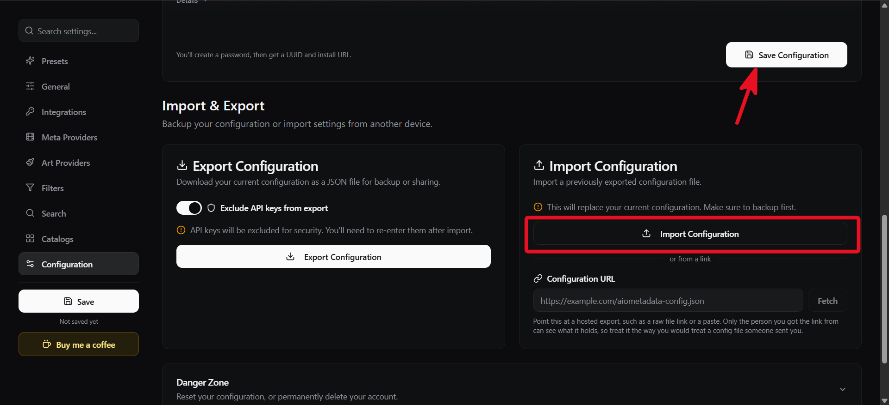
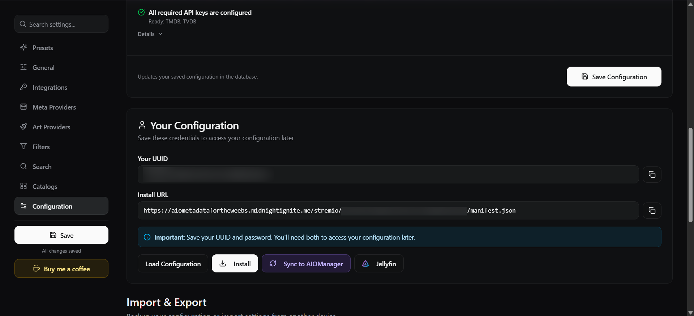
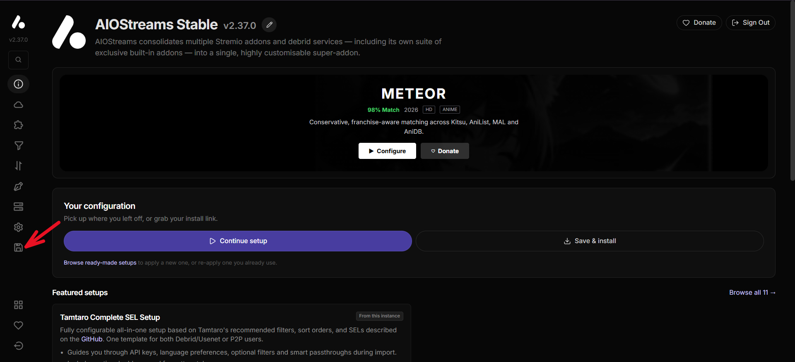
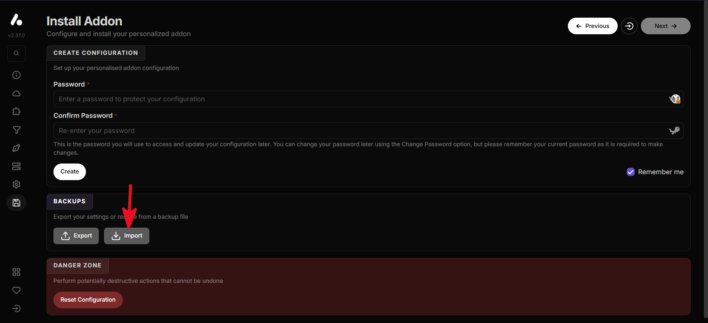
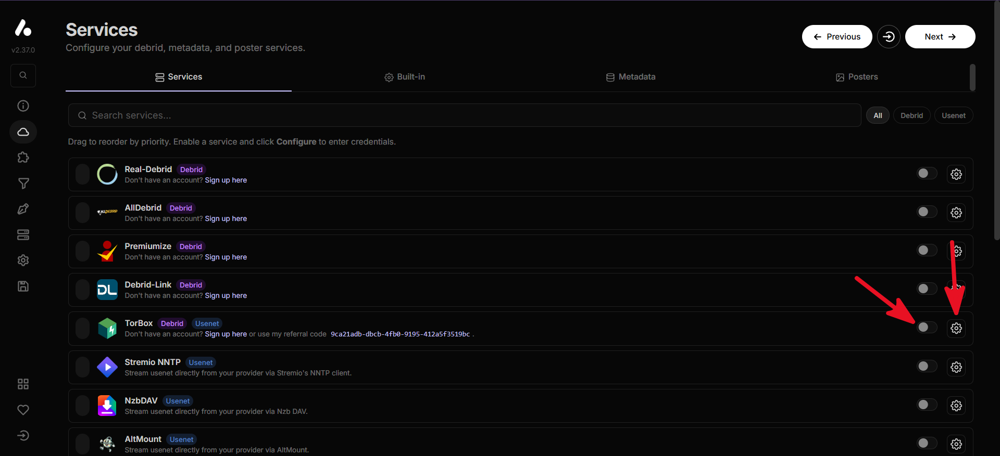
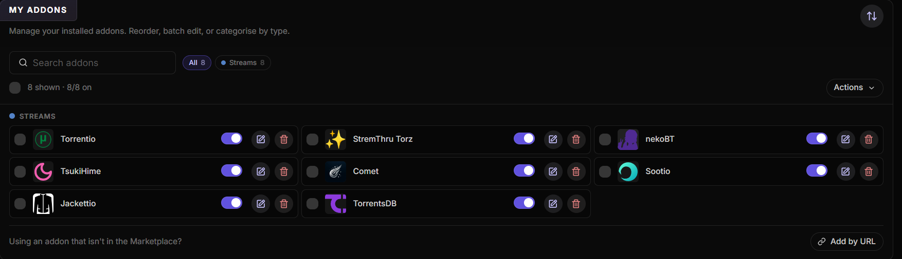
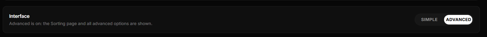
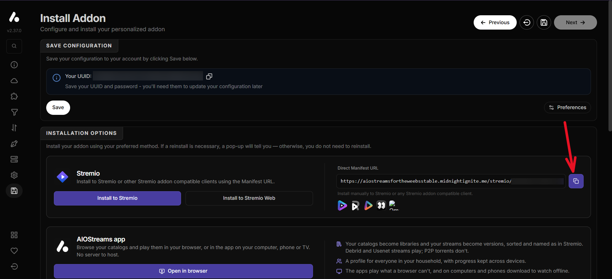

# Configuration

**English** · [Português](configuration.pt-BR.md) · ← [Back to the README](../README.md)

Copy `.env.example` to `.env`. Locally nothing is required (only the Discord Activity needs the first two); on a server set at least `SESSION_SECRET` and `TRUST_PROXY`. Variables already in the environment (systemd, Docker) win over the file.

| Variable | Description |
|---|---|
| `VITE_DISCORD_CLIENT_ID` | Discord application ID used by the Activity |
| `DISCORD_CLIENT_SECRET` | Discord application secret, used by `/api/token` for the OAuth2 exchange |
| `SESSION_SECRET` | Signs the session tokens. Without it a new one is generated at each start |
| `ALLOWED_ORIGINS` | Extra origins (comma separated) allowed to call the API and open the WebSocket. Default: same origin + the Discord Activity |
| `TRUST_PROXY` | `1` behind Caddy/nginx: the client IP (used for rate limits) comes from `X-Forwarded-For` |
| `FFMPEG_PATH` | *(optional)* FFmpeg executable. Otherwise `ffmpeg` on the `PATH`, then known Windows paths |
| `PYTHON_PATH` | *(optional)* Python 3.10+ for the subtitle extractor. Otherwise `python3`, `python`, `py -3` |
| `MAX_UPLOAD_DISK_GB` / `MAX_UPLOAD_FILE_GB` | Disk quota for uploads (default 20) and size limit per upload (default 50) |
| `UPLOAD_TTL_HOURS` | Hours an upload is kept after its room closes (default 24) |
| `REDIS_URL` | *(optional)* A local Redis, e.g. `redis://127.0.0.1:6379`. Rooms then survive a restart and the upload index is kept in it. See [Redis](deployment.md#optional-redis) |
| `ROOM_STATE_TTL_HOURS` / `ROOM_HOST_GRACE_SECONDS` | With Redis: how long a room's saved state is valid (default 24) and how long the previous host has to come back after a restart before someone else takes over (default 60) |
| `UPLOAD_IDLE_HOURS` | Hours an upload in an open room may go unread before it is removed (default 24) |
| `MIN_FREE_DISK_GB` | Free space to keep on the machine's disk; uploads are refused below it (default 5) |
| `CATALOG_URL` | *(optional)* Stremio addon that feeds the catalog: the install URL or base of an [AIOMetadata](https://github.com/cedya77/aiometadata) (`https://…/stremio/<id>/manifest.json`), or any addon with catalogs. Empty = the public Cinemeta addon from Stremio. Keep it only in the server `.env`: it carries your config and keys |
| `JIKAN_URL` | *(optional)* API of the MyAnimeList score shown on anime pages: a Jikan-compatible instance (`GET <base>/anime/<id>` with `data.score`), base with the version prefix. The official Jikan API was shut down, so use a third-party public instance or your own. Empty = the default public instance (jikan-edge). The score is requested apart from the page (3 tries on the server, then the browser tries again), cached for 24 h; without an answer the page just omits it. Anime found by IMDb id are matched to their MyAnimeList id through the source's anime search |
| `MAX_CACHE_GB` | Limit for `.cache/` (default 10, includes the HLS segments); the least recently used is deleted first |
| `MAX_FFMPEG_PROCS` | FFmpeg/Python processes at once (default 8) |
| `FFMPEG_THROUGHPUT_MBPS` | Starting guess (default 40) of how fast FFmpeg reads a CDN, used to choose between the subtitle extractor and reading the whole file. After real reads, the server uses the measured average per CDN host |
| `SCREEN_SHARE_ENABLED` | *(optional)* `1` turns screen sharing on. It also needs the three variables below; without them it stays off. See [Screen sharing](screen-sharing.md#screen-sharing) |
| `MOQ_RELAY_URL` / `MOQ_TOKEN_PUBLISH` / `MOQ_TOKEN_SUBSCRIBE` | The MoQ relay (`https://…`, no token in it) and its two tokens: one that can publish (only ever handed to the Host who is streaming) and one that can only watch. **Secrets**: keep them in the server `.env` only |
| `SCREEN_SHARE_MAX_LIVE` | Rooms that may stream at once (default 10). The relay is in beta and does not meter or bill yet, so the cap is ours |
| `ALLOW_PRIVATE_URLS` | Local tests only: lets the proxy reach private network addresses. Keep empty in production |
| `DISABLE_HMR` | *(optional)* `true` disables Vite hot reload |

## Tutorials

### Getting the Cloudflare MoQ relay and tokens (screen sharing)

Screen sharing needs a relay. Lunio uses [Cloudflare's managed MoQ relay](https://developers.cloudflare.com/) (beta). You need a Cloudflare account; the relay is created once and its secrets go in the server's `.env`.

> Cloudflare asks you to add a credit card to use MoQ, because it is a paid product. According to Cloudflare, nothing is charged during the beta.

1. In the Cloudflare dashboard, create a **MoQ relay** (the option is in the Media / Realtime area; it is a beta, so its place and name may change — the Cloudflare docs have the current path). Give it any name, for example `lunio`.
2. Creating the relay gives you its **URL** (`https://…`) and **two tokens**: one that can publish and watch, and one that can only watch. **Cloudflare shows the tokens only once**: copy them right away. The relay has one address per protocol draft; use the **draft-16** one.
3. Put them in the server's `.env`:

```ini
SCREEN_SHARE_ENABLED=1
MOQ_RELAY_URL=https://<your relay>      # the draft-16 URL only, with no token in it
MOQ_TOKEN_PUBLISH=<token that publishes>
MOQ_TOKEN_SUBSCRIBE=<token that only watches>
```

4. Restart Lunio. The **Status** tab shows the screen sharing row, and the "Share your screen" option on the Home stops being unavailable.

Keep these values only in the server `.env`: never commit them or paste them in chats. Lunio hands the publish token only to the Host who is streaming and the watch-only one to everyone else; the video itself is encrypted, see [Screen sharing](screen-sharing.md).

If you lose a token, create a new one for the same relay in the dashboard or with the Cloudflare API (`POST /accounts/<account>/moq/relays/<relay>/tokens`, which requires an expiration of up to one year) and update the `.env`.

### Setting up the catalog (AIOMetadata)

The catalog needs a Stremio addon that provides **metadata** (posters, descriptions, seasons, episodes). Two options:

- **Do nothing.** Without `CATALOG_URL`, Lunio uses Stremio's public **Cinemeta** addon. It works out of the box.
- **Use [AIOMetadata](https://github.com/cedya77/aiometadata)**, which lets you choose the catalogs (anime, streaming services, genres…) and the language. Below is the configuration Lunio uses, ready to import.

You can run your own AIOMetadata, or use a public instance such as <https://aiometadatafortheweebs.midnightignite.me/>. A public instance is run by someone else and stores your configuration, so do not put keys of your own in it.

1. Open the instance. If it shows the setup wizard, click **Skip**.

   

2. In the side menu, open **Configuration**. (The **General** page is where you pick the display language and the time zone; the imported configuration uses Portuguese (Brazil) and Brasília.)

   

3. Under **Import & Export**, import the Lunio configuration. Either paste its address in **Configuration URL** and click **Fetch** (`https://lunio.stream/aiometadata-config.json`), or download [aiometadata-config.json](../public/aiometadata-config.json) and use **Import Configuration**. It has no keys in it. Then click **Save Configuration** (it asks you for a password the first time).

   

   On a public instance the TMDB and TVDB keys are already set. On your own instance, enter yours in **Integrations**.

4. After saving, **Your Configuration** shows your UUID, your password and the **Install URL**. Copy the Install URL (`https://…/stremio/<id>/manifest.json`) and put it in the server's `.env`:

   

```ini
CATALOG_URL=https://<instance>/stremio/<id>/manifest.json
```

Restart Lunio and open the **Catalog** tab: the rows are the catalogs of your configuration, in the same order. Keep your UUID and password: you need them to change the configuration later. The Install URL carries your configuration, so it stays only in the server `.env`; it never reaches the browser or the logs.

If you use the MyAnimeList score on anime pages, also see `JIKAN_URL` above.

### Setting up streams (AIOStreams)

The catalog only lists titles. To **watch**, each person adds a video addon in the catalog's **Addons** button; [AIOStreams](https://github.com/Viren070/AIOStreams) is a common choice because it gathers several sources in one addon. Below is the configuration Lunio uses (sorting, filters and eight stream addons), ready to import.

You can run your own AIOStreams or use a public instance such as <https://aiostreamsfortheweebsstable.midnightignite.me/>. As with AIOMetadata, a public instance stores your configuration, including the debrid credentials you enter.

1. Open the instance. The side menu has the pages of the configuration.

   

2. Go to the last page of the menu (**Save & Install**), under **Backups** click **Import** and choose [aiostreams-config.json](../public/aiostreams-config.json) (also at `https://lunio.stream/aiostreams-config.json`; download it first). The imported configuration has no credentials.

   

3. Open **Services**, turn on your debrid service and click the gear to enter its credentials (TorBox in the picture; any of them works). This is the step that is yours: the file brings no keys.

   

4. The configuration brings its addons: open **Addons** to see them (Torrentio, StremThru Torz, nekoBT, TsukiHime, Comet, Sootio, Jackettio and TorrentsDB).

   

   If you do not see the Sorting page and the other advanced options, switch the interface to **Advanced** in the settings.

   

5. Back on **Save & Install**, create a password and click **Create** / **Save**. You get your UUID and the **Direct Manifest URL**. Copy the manifest URL (`https://…/stremio/<id>/manifest.json`).

   

6. In Lunio, open **Catalog → Addons**, paste the manifest URL and add it.
7. Open a movie or an episode: **Where to watch** lists the addon's streams. Each one has a badge saying whether it is likely to play in your browser (HEVC, Dolby Vision or DTS audio may not). Click one to create a room and start playing.

The manifest URL has your keys, so Lunio keeps it **only in your browser** (`localStorage`); the server never sees it. Only streams with a direct `url` are listed (no magnet links).
