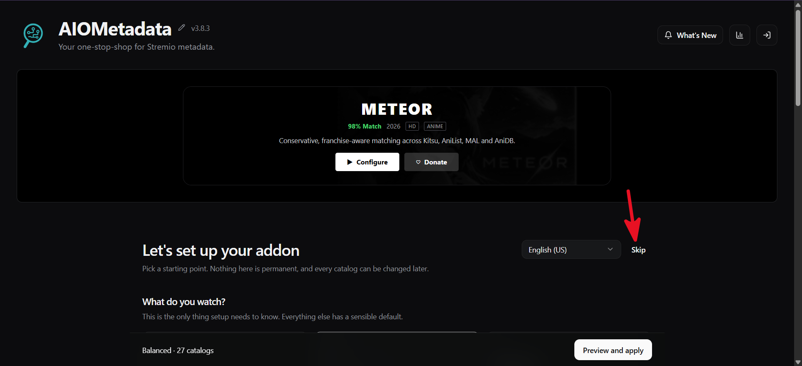
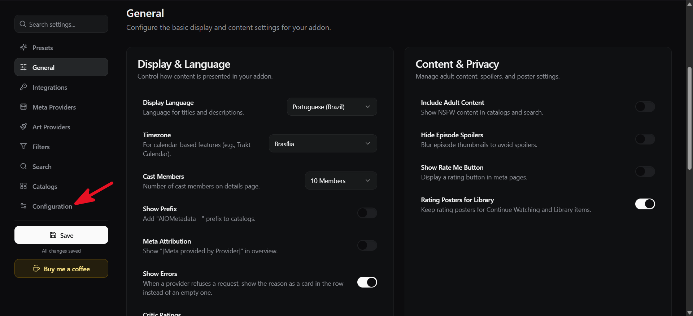
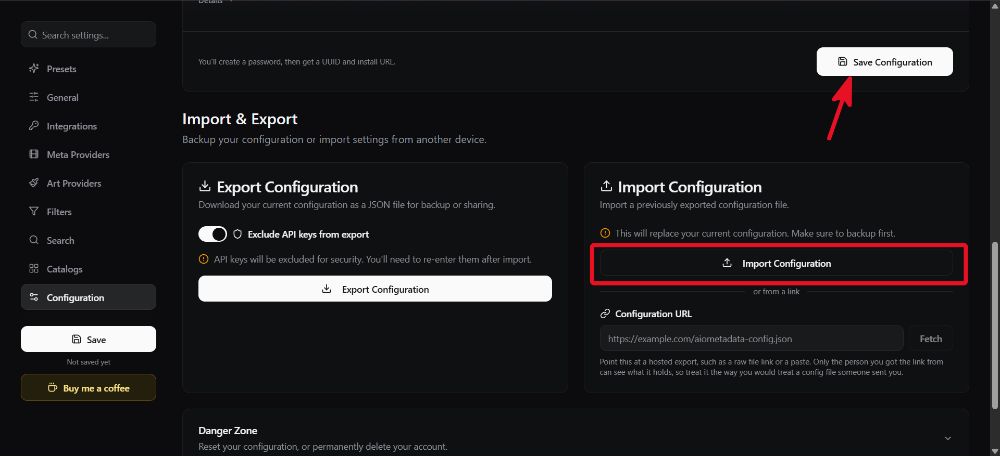
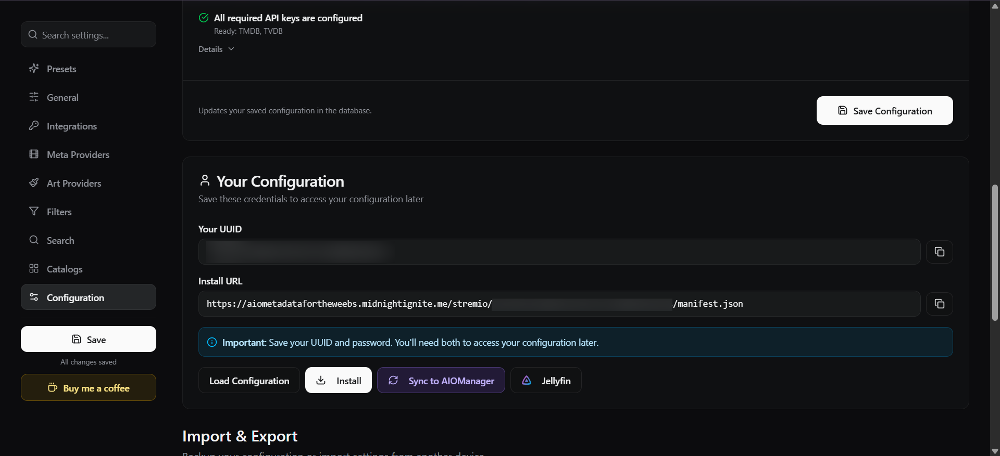
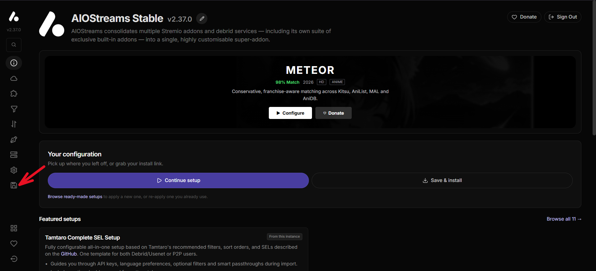
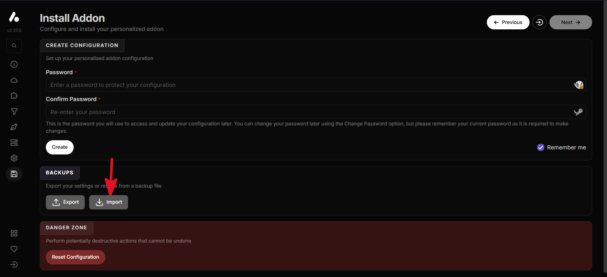
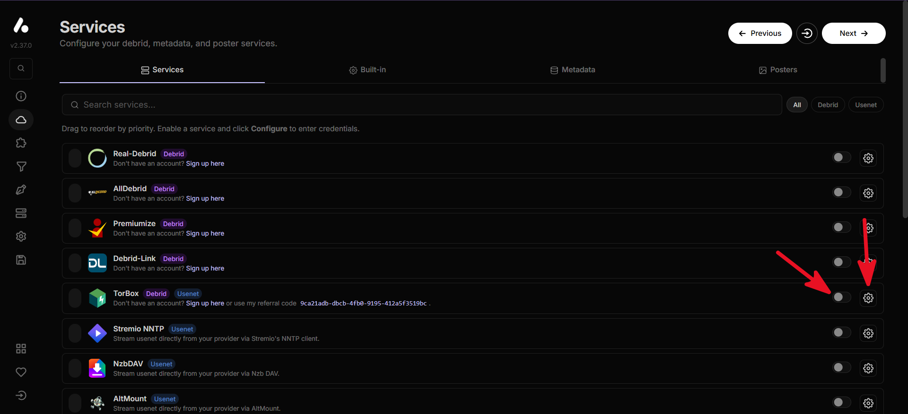
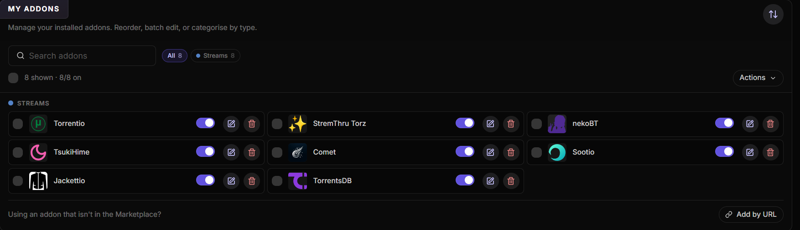
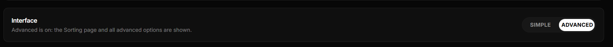
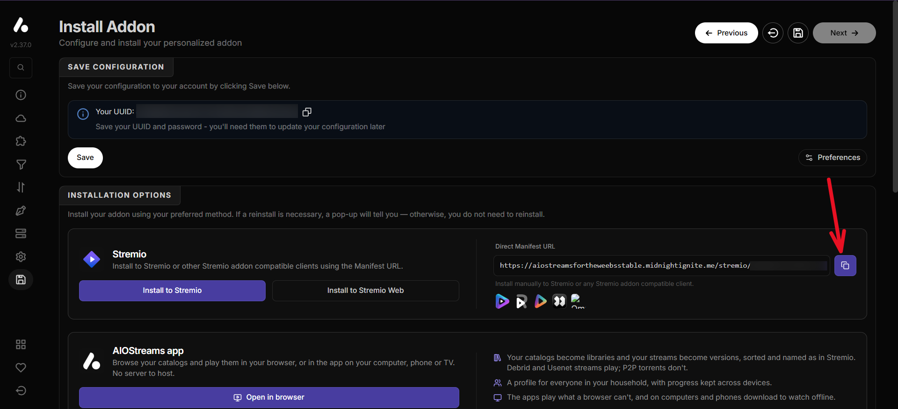

# Configuração

[English](configuration.md) · **Português** · ← [Voltar ao README](../README.pt-BR.md)

Copie `.env.example` para `.env`. Localmente nada é obrigatório (só a Atividade do Discord usa as duas primeiras); em servidor, defina pelo menos `SESSION_SECRET` e `TRUST_PROXY`. Variáveis já definidas no ambiente (systemd, Docker) têm prioridade sobre o arquivo.

| Variável | Descrição |
|---|---|
| `VITE_DISCORD_CLIENT_ID` | ID da aplicação do Discord usada pela Atividade |
| `DISCORD_CLIENT_SECRET` | Segredo da aplicação do Discord, usado pelo `/api/token` na troca OAuth2 |
| `SESSION_SECRET` | Assina os tokens de sessão. Sem ele, um novo é gerado a cada início |
| `ALLOWED_ORIGINS` | Origens extras (separadas por vírgula) autorizadas a chamar a API e abrir o WebSocket. Padrão: a própria origem + a Atividade do Discord |
| `TRUST_PROXY` | `1` atrás de Caddy/nginx: o IP do cliente (usado nos limites) vem do `X-Forwarded-For` |
| `FFMPEG_PATH` | *(opcional)* Executável do FFmpeg. Senão, `ffmpeg` no `PATH` e depois caminhos conhecidos do Windows |
| `PYTHON_PATH` | *(opcional)* Python 3.10+ do extrator de legendas. Senão, `python3`, `python`, `py -3` |
| `MAX_UPLOAD_DISK_GB` / `MAX_UPLOAD_FILE_GB` | Cota de disco dos envios (padrão 20) e tamanho máximo de um envio (padrão 50) |
| `UPLOAD_TTL_HOURS` | Horas que um envio fica depois que a sala fecha (padrão 24) |
| `UPLOAD_IDLE_HOURS` | Horas que um envio de sala aberta pode ficar sem ser lido antes de ser removido (padrão 24) |
| `MIN_FREE_DISK_GB` | Espaço livre a manter no disco da máquina; abaixo disso os envios são recusados (padrão 5) |
| `REDIS_URL` | *(opcional)* Um Redis local, ex.: `redis://127.0.0.1:6379`. Com ele as salas sobrevivem a um restart e o índice dos envios fica nele. Veja [Redis](deployment.pt-BR.md#opcional-redis) |
| `ROOM_STATE_TTL_HOURS` / `ROOM_HOST_GRACE_SECONDS` | Com Redis: por quanto tempo o estado salvo de uma sala vale (padrão 24) e quanto tempo o Host anterior tem para voltar depois de um restart antes de outra pessoa assumir (padrão 60) |
| `CATALOG_URL` | *(opcional)* Addon do Stremio que alimenta o catálogo: a URL de instalação ou a base de um [AIOMetadata](https://github.com/cedya77/aiometadata) (`https://…/stremio/<id>/manifest.json`), ou qualquer addon com catálogos. Vazio = o addon público Cinemeta do Stremio. Deixe só no `.env` do servidor: ela leva a sua configuração e chaves |
| `JIKAN_URL` | *(opcional)* API da nota do MyAnimeList mostrada na página dos animes: uma instância compatível com o Jikan (`GET <base>/anime/<id>` com `data.score`), base com o prefixo de versão. A API oficial do Jikan foi desligada, então use uma instância pública de terceiros ou a sua. Vazia = a instância pública padrão (jikan-edge). A nota é pedida à parte da página (3 tentativas no servidor e depois o navegador tenta de novo), fica em cache por 24 h; sem resposta, a página só omite a nota. Animes que chegam pelo id do IMDb são ligados ao id do MyAnimeList pela busca de anime da fonte |
| `MAX_CACHE_GB` | Limite de `.cache/` (padrão 10, inclui os segmentos HLS); apaga primeiro o menos usado |
| `MAX_FFMPEG_PROCS` | Processos FFmpeg/Python ao mesmo tempo (padrão 8) |
| `FFMPEG_THROUGHPUT_MBPS` | Palpite inicial (padrão 40) de quão rápido o FFmpeg lê um CDN, usado para escolher entre o extrator de legendas e ler o arquivo todo. Depois de leituras reais, o servidor usa a média medida por host do CDN |
| `SCREEN_SHARE_ENABLED` | *(opcional)* `1` liga a transmissão de tela. Precisa também das três variáveis abaixo; sem elas continua desligada. Veja [Transmissão de tela](screen-sharing.pt-BR.md#transmissão-de-tela) |
| `MOQ_RELAY_URL` / `MOQ_TOKEN_PUBLISH` / `MOQ_TOKEN_SUBSCRIBE` | O relay MoQ (`https://…`, sem o token na URL) e seus dois tokens: um que publica (só entregue ao Host que está transmitindo) e outro que só assiste. **Segredos**: deixe só no `.env` do servidor |
| `SCREEN_SHARE_MAX_LIVE` | Quantas salas podem transmitir ao mesmo tempo (padrão 10). O relay está em beta e ainda não mede nem cobra, então o teto é nosso |
| `ALLOW_PRIVATE_URLS` | Só para testes locais: deixa o proxy alcançar endereços de rede privada. Mantenha vazio em produção |
| `DISABLE_HMR` | *(opcional)* `true` desliga o hot reload do Vite |

## Tutoriais

### Pegando o relay MoQ e os tokens da Cloudflare (transmissão de tela)

A transmissão de tela precisa de um relay. O Lunio usa o [relay MoQ gerenciado da Cloudflare](https://developers.cloudflare.com/) (beta). Você precisa de uma conta na Cloudflare; o relay é criado uma vez e os segredos vão no `.env` do servidor.

> A Cloudflare pede um cartão de crédito para usar o MoQ, porque é um produto pago. Segundo a própria Cloudflare, nada é cobrado durante o beta.

1. No painel da Cloudflare, crie um **relay MoQ** (a opção fica na área de Media / Realtime; como é um beta, o lugar e o nome podem mudar — a documentação da Cloudflare tem o caminho atual). Dê o nome que quiser, por exemplo `lunio`.
2. Ao criar o relay você recebe a **URL** dele (`https://…`) e **dois tokens**: um que publica e assiste, e outro que só assiste. **A Cloudflare mostra os tokens uma única vez**: copie na hora. O relay tem um endereço para cada versão (draft) do protocolo; use o do **draft-16**.
3. Coloque no `.env` do servidor:

```ini
SCREEN_SHARE_ENABLED=1
MOQ_RELAY_URL=https://<seu relay>      # só a URL do draft-16, sem token
MOQ_TOKEN_PUBLISH=<token que publica>
MOQ_TOKEN_SUBSCRIBE=<token que só assiste>
```

4. Reinicie o Lunio. A aba **Status** mostra a linha da transmissão de tela, e a opção "Compartilhar sua tela" da Home deixa de aparecer como indisponível.

Guarde esses valores só no `.env` do servidor: nunca os coloque no git nem em conversas. O Lunio entrega o token de publicar apenas ao Host que está transmitindo e o de só assistir aos demais; o vídeo em si vai criptografado, veja [Transmissão de tela](screen-sharing.pt-BR.md).

Se perder um token, crie outro para o mesmo relay no painel ou pela API da Cloudflare (`POST /accounts/<conta>/moq/relays/<relay>/tokens`, que exige uma validade de até um ano) e atualize o `.env`.

### Configurando o catálogo (AIOMetadata)

O catálogo precisa de um addon do Stremio que forneça os **metadados** (pôsteres, descrições, temporadas, episódios). Duas opções:

- **Não fazer nada.** Sem `CATALOG_URL`, o Lunio usa o addon público **Cinemeta** do Stremio. Funciona de cara.
- **Usar o [AIOMetadata](https://github.com/cedya77/aiometadata)**, que deixa você escolher os catálogos (anime, serviços de streaming, gêneros…) e o idioma. Abaixo está a configuração que o Lunio usa, pronta para importar.

Você pode hospedar o seu próprio AIOMetadata ou usar uma instância pública, como <https://aiometadatafortheweebs.midnightignite.me/>. A instância pública é de outra pessoa e guarda a sua configuração, incluindo suas chaves.

1. Abra a instância. Se aparecer o assistente de configuração, clique em **Skip**.

   

2. No menu lateral, abra **Configuration**. (Em **General** você escolhe o idioma de exibição e o fuso horário; a configuração importada usa português (Brasil) e Brasília.)

   

3. Em **Import & Export**, importe a configuração do Lunio. Cole o endereço em **Configuration URL** e clique em **Fetch** (`https://lunio.stream/aiometadata-config.json`), ou baixe o [aiometadata-config.json](../public/aiometadata-config.json) e use **Import Configuration**. Ela não tem nenhuma chave. Depois clique em **Save Configuration** (na primeira vez ele pede uma senha).

   

   Na instância pública as chaves do TMDB e do TVDB já estão configuradas. Na sua própria instância, coloque as suas em **Integrations**.

4. Depois de salvar, **Your Configuration** mostra o seu UUID, a senha e a **Install URL**. Copie a Install URL (`https://…/stremio/<id>/manifest.json`) e coloque no `.env` do servidor:

   

```ini
CATALOG_URL=https://<instância>/stremio/<id>/manifest.json
Ex: https://aiometadatafortheweebs.midnightignite.me/stremio/abc123/manifest.json
```

Reinicie o Lunio e abra a aba **Catálogo**: as fileiras são os catálogos da sua configuração, na mesma ordem. Guarde o UUID e a senha: você precisa deles para mudar a configuração depois. A Install URL leva a sua configuração, então fica só no `.env` do servidor; ela nunca chega ao navegador nem aos logs.

Se usar a nota do MyAnimeList nas páginas de anime, veja também `JIKAN_URL` acima.

### Configurando os streams (AIOStreams)

O catálogo só lista títulos. Para **assistir**, cada pessoa adiciona um addon de vídeo no botão **Addons** do catálogo; o [AIOStreams](https://github.com/Viren070/AIOStreams) é uma escolha comum porque reúne várias fontes num só addon. Abaixo está a configuração que o Lunio usa (ordenação, filtros e oito addons de stream), pronta para importar.

Você pode hospedar o seu próprio AIOStreams ou usar uma instância pública, como <https://aiostreamsfortheweebsstable.midnightignite.me/>. Como no AIOMetadata, a instância pública guarda a sua configuração, inclusive as credenciais do debrid que você colocar.

1. Abra a instância. O menu lateral tem as páginas da configuração.

   

2. Vá até a última página do menu (**Save & Install**), em **Backups** clique em **Import** e escolha o [aiostreams-config.json](../public/aiostreams-config.json) (também em `https://lunio.stream/aiostreams-config.json`; baixe o arquivo antes). A configuração importada não tem credenciais.

   

3. Abra **Services**, ligue o seu serviço debrid e clique na engrenagem para colocar as credenciais (TorBox na imagem; qualquer um serve). Este passo é seu: o arquivo não traz chaves.

   

4. A configuração já traz os addons: abra **Addons** para ver (Torrentio, StremThru Torz, nekoBT, TsukiHime, Comet, Sootio, Jackettio e TorrentsDB).

   

   Se a página Sorting e as outras opções avançadas não aparecerem, troque a interface para **Advanced** nas configurações.

   

5. De volta em **Save & Install**, crie uma senha e clique em **Create** / **Save**. Você recebe o UUID e a **Direct Manifest URL**. Copie a URL do manifest (`https://…/stremio/<id>/manifest.json`).

   

6. No Lunio, abra **Catálogo → Addons**, cole a URL do manifest e adicione.
7. Abra um filme ou um episódio: **Onde assistir** lista os streams do addon. Cada um tem uma etiqueta dizendo se deve tocar no seu navegador (HEVC, Dolby Vision ou áudio DTS podem não tocar). Clique em um para criar uma sala e começar a tocar.

A URL do manifest tem as suas chaves, então o Lunio a guarda **só no seu navegador** (`localStorage`); o servidor nunca a vê. Só aparecem streams com `url` direta (sem links magnet).
